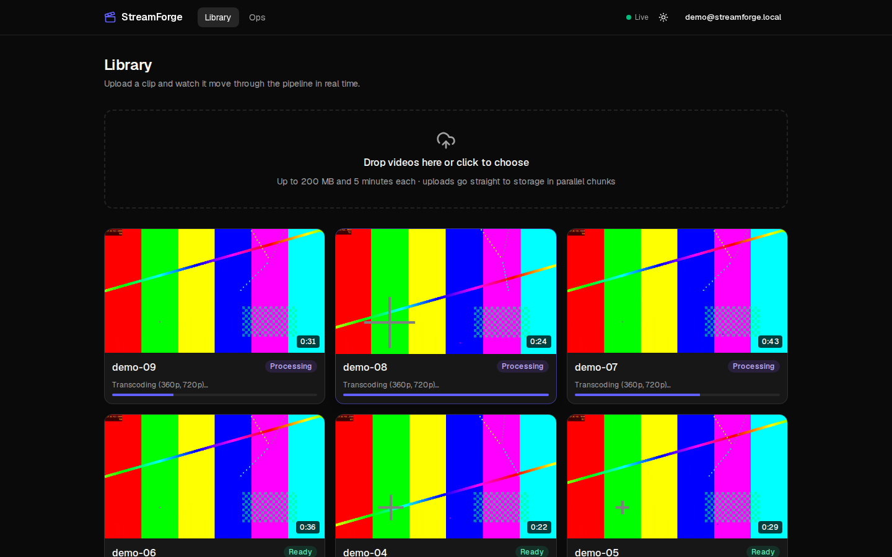
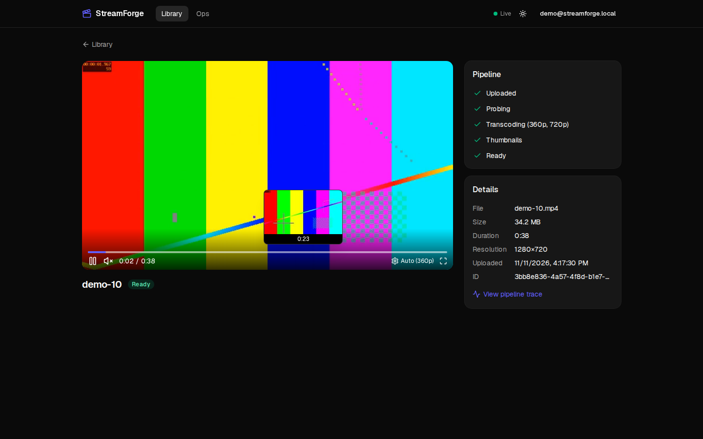
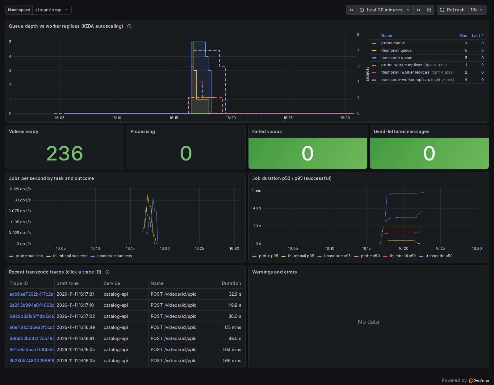
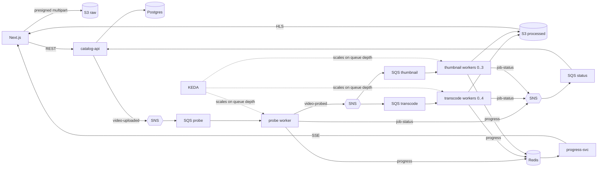

# StreamForge

[](https://github.com/LucasTyph/streamforge/actions/workflows/ci.yml)
[](https://github.com/LucasTyph/streamforge/actions/workflows/release.yml)


[](LICENSE)

An event-driven video processing platform. Drop a video in the browser; it uploads
straight to object storage, and a pipeline of autoscaling workers probes it, transcodes it
to adaptive HLS and cuts thumbnails, with live progress in the UI. The whole thing,
including autoscaling, GitOps and full observability, runs on a laptop with one command
and costs nothing.



| Player with scrub previews | Queue depth vs autoscaled workers |
|---|---|
|  |  |

## What it does
- **Direct-to-storage uploads**: presigned multipart upload from the browser, parallel
  chunks with per-chunk progress, retries and cancel.
- **Event-driven pipeline**: SNS fans out to SQS queues; Go workers run ffprobe and ffmpeg
  (360p + 720p HLS, never upscaled) and build a poster, sprite sheet and WebVTT index.
- **Live progress**: per-stage progress bars over Server-Sent Events.
- **Adaptive player**: hls.js, quality selector, thumbnail previews while scrubbing.
- **Scale to zero**: KEDA scales each worker on its queue depth, from 0 to N and back.
- **Built to fail safely**: idempotent jobs, visibility heartbeats, retries, dead-letter
  queues with an Ops page to inspect and redrive, graceful shutdown.
- **One trace per video**: OpenTelemetry context travels in the message attributes, so
  a video's path through the API and three workers is a single trace, linked to its logs.
- **GitOps delivery**: GitHub Actions builds multi-arch images; ArgoCD syncs the cluster
  from git.
- **Infrastructure as code**: one Terraform module creates the buckets, topics and queues
  locally and (hardened) on real AWS.

## Run it in one command
Needs Linux or WSL2 with Docker (about 10 GB of RAM for the full stack). Install the
pinned tools with `scripts/install-tools.sh`, then:

```bash
make up      # k3d cluster, Postgres operator, KEDA, Prometheus/Grafana/Loki/Tempo and the app
make demo    # upload 20 clips at once and watch the workers scale
```
- App: http://streamforge.localhost (`demo@streamforge.local` / `demo-password`)
- Grafana: http://grafana.streamforge.localhost, dashboard **StreamForge / Pipeline**

`make up-lite` skips observability (about 3 GB). `make down` removes everything.
`make help` lists every target.

## Architecture

More detail, including the life of a video as a sequence diagram:
[docs/architecture.md](docs/architecture.md).

**Stack:** Go (workers, SSE service) · TypeScript, Fastify, Drizzle (API) · Next.js,
Tailwind, shadcn/ui, hls.js · Postgres (CloudNativePG), Redis · Kubernetes on k3d, Helm,
KEDA, ArgoCD · Terraform · GitHub Actions, GHCR · OpenTelemetry, Prometheus, Loki, Tempo,
Grafana · k6, Playwright, Testcontainers.

**AWS, honestly:** the code uses the official AWS SDKs for S3, SNS and SQS, pointed at
local emulators (SeaweedFS, ElasticMQ and a small SNS emulator written for this project).
The Terraform for real AWS (VPC, EKS, RDS, ElastiCache, KMS, IAM roles per service) is
validated, linted and security-scanned in CI but has never been applied
([ADR-002](docs/adr/002-aws-emulation.md), [infra/terraform/aws](infra/terraform/aws/README.md)).

## Measured results
All numbers come from runs on one laptop (Windows 11, WSL2 with 10 GB and 6 vCPUs, k3d);
commands, dates and raw output are in [docs/results.md](docs/results.md).

| What | Result |
|---|---|
| Autoscaling | 20 uploads: workers 0 → 4 transcoders within ~20 s, back to 0 about 50 s after the queue drained |
| Batch of 20 clips (585 MB) | 305 s with 1 transcode worker, 202 s with 2 (34% less); 4 gave no further gain (CPU-bound on 6 vCPUs) |
| Chaos test | 28 worker pods killed during a 20-clip batch: 20/20 videos ready, every HLS segment intact, 0 messages dead-lettered |
| API load (k6) | 200 req/s for 1 min: 12,003 requests, 0 failed, p95 10.9 ms |
| Upload burst (k6) | 10 concurrent 25.5 MB multipart uploads finished in 4.9 s, 0 failed |
| Tracing | one video = one trace, 31 spans across 4 services |
| GitOps loop | a pushed commit was serving in staging 228 s later (CI build, tag bump, ArgoCD sync) |
| Cold start | `make up-lite` from nothing to a working app in 243 s |

The benchmarks also found real bugs, which is what they are for: a storage service
OOM-killed by upload bursts, messages hidden for minutes when a worker was scaled down
mid-poll, and videos stuck in "processing" when a worker was killed on its last retry.
Each is described with before/after numbers in docs/results.md and the ADRs.

## Design decisions
| ADR | Decision |
|---|---|
| [001](docs/adr/001-tech-choices.md) | Tech choices and pinned versions |
| [002](docs/adr/002-aws-emulation.md) | AWS APIs through token-free local emulators |
| [003](docs/adr/003-pipeline-reliability.md) | Idempotency, retries, DLQs, graceful shutdown, short-claim receives |
| [004](docs/adr/004-live-progress.md) | Live progress over SSE with Redis pub/sub |
| [005](docs/adr/005-kubernetes.md) | Helm library chart, NetworkPolicies, in-cluster Terraform |
| [006](docs/adr/006-cicd-gitops.md) | CI/CD, multi-arch builds, GitOps with ArgoCD |
| [007](docs/adr/007-autoscaling-observability.md) | KEDA on queue depth, tracing through SNS/SQS, dashboards as code |

Runbooks: [DLQ is filling](docs/runbooks/dlq-filling.md) ·
[worker stuck](docs/runbooks/worker-stuck.md) ·
[Terraform job](docs/runbooks/terraform-local-job.md).

## Development
```bash
make dev                 # emulators in Docker; API (:4000) and web (:3000) with hot reload
make test                # Go + TypeScript unit tests
make test-integration    # Testcontainers (real ffmpeg, S3, SQS) + API tests against the dev stack
make test-e2e            # Playwright: upload -> ready -> plays
make lint security       # vet, tsc, terraform fmt, helm lint; gitleaks, Trivy, actionlint
make benchmark chaos     # the batch benchmark and the chaos test from the table above
make load                # k6 API load test
```
GitOps mode (`make gitops-up`) installs ArgoCD and lets it deploy everything from git,
using the images CI published ([ADR-006](docs/adr/006-cicd-gitops.md)).

## What I'd change for production
- **Real AWS services** instead of emulators, with CloudFront and signed cookies in front
  of the processed bucket (locally it is readable without sign-in).
- **Node autoscaling** (Karpenter) next to KEDA: here the pods scale but the "nodes" are
  one laptop, which is why 4 transcoders are no faster than 2.
- **Transcoding as Kubernetes Jobs** (KEDA ScaledJob) or with a longer drain, so a
  scale-down never interrupts a running transcode.
- **Secrets** from External Secrets or Sealed Secrets instead of a generated local file.
- **TLS everywhere** and `Secure` cookies; the local ingress is plain HTTP.
- **Browser-side tracing** and SLO-based alerts; traces currently start at the API.
- **Resumable uploads across page reloads**, virus scanning and per-user quotas.
- **A managed queue** in place of ElasticMQ, which keeps messages in memory in a single pod.

## License
[MIT](LICENSE)
