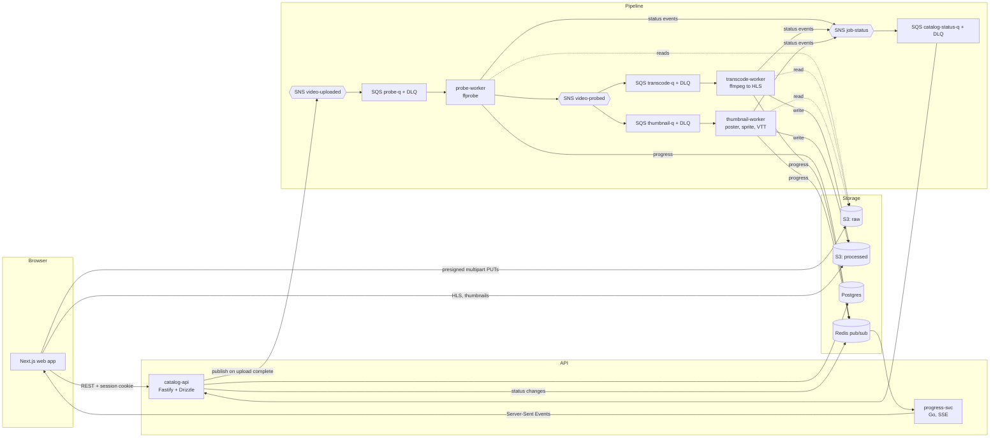
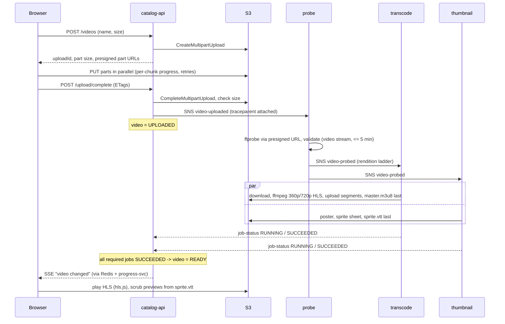

# Architecture

StreamForge turns an uploaded video into adaptive HLS with thumbnails. The browser
uploads straight to object storage; everything after that is driven by events, and each
stage is a small worker that scales on its queue.

## Components



## Life of a video



## Where the reliability comes from
| Concern | Mechanism | Detail |
|---|---|---|
| At-least-once delivery | idempotent jobs | deterministic output keys; the manifest (`master.m3u8`, `sprite.vtt`) is written last and doubles as the commit marker ([ADR-003](adr/003-pipeline-reliability.md)) |
| Out-of-order / duplicate status events | job state machine | unique `(video_id, task)`, `SUCCEEDED` is terminal, stale events ignored, row lock per video |
| Long jobs | visibility heartbeats | workers extend the SQS visibility timeout while ffmpeg runs |
| Failures | retries, then DLQ | 3 receives, backoff, readable failure reason; Ops page lists and redrives DLQ messages |
| Scale-down and deploys | graceful shutdown | stop polling, finish or release the message, then exit |
| Bad input | validation in probe | not a video / too long ends `FAILED` with a reason, without retries |

## Platform
| Layer | What runs | Notes |
|---|---|---|
| Cluster | k3d (k3s), 1 server + 2 agents | Traefik ingress, local registry ([ADR-005](adr/005-kubernetes.md)) |
| Packaging | Helm: `sf-lib` library + `streamforge-deps` + `streamforge` | probes, limits, PDBs, default-deny NetworkPolicies, non-root, read-only root FS |
| Data | CloudNativePG Postgres, Redis | migrations under an advisory lock |
| AWS APIs | SeaweedFS (S3), ElasticMQ (SQS), sns-shim (SNS) | official AWS SDKs with configurable endpoints ([ADR-002](adr/002-aws-emulation.md)) |
| IaC | Terraform module `pipeline` | applied in-cluster to the emulators; hardened variant for real AWS (validated, never applied) |
| Autoscaling | KEDA on SQS depth (workers 0..N), HPA on API CPU | [ADR-007](adr/007-autoscaling-observability.md) |
| Observability | Prometheus, Loki, Tempo, OTel Collector, Grafana | one trace per video; logs linked to traces |
| Delivery | GitHub Actions to GHCR, ArgoCD app-of-apps | changed services only, multi-arch, GitOps tag bumps ([ADR-006](adr/006-cicd-gitops.md)) |

## Repository map
```
apps/web/                  Next.js UI (upload, library, player, Ops)
services/catalog-api/      REST API, job state machine, status consumer, admin/DLQ endpoints
go/cmd/{probe,transcode,thumbnail,progress,sns-shim}
go/internal/               worker loop, media (ffmpeg args), pipeline handlers, telemetry, sse
deploy/                    docker-compose (dev), k3d, Helm charts, ArgoCD, GitOps env files
infra/terraform/           modules/pipeline, local (emulators), aws (real AWS, never applied)
observability/             chart values, dashboards (generated), alert rules
loadtest/k6/               API and upload load tests
scripts/                   test media, upload CLI, benchmark, chaos, tool installer
docs/                      ADRs, runbooks, measured results
```
